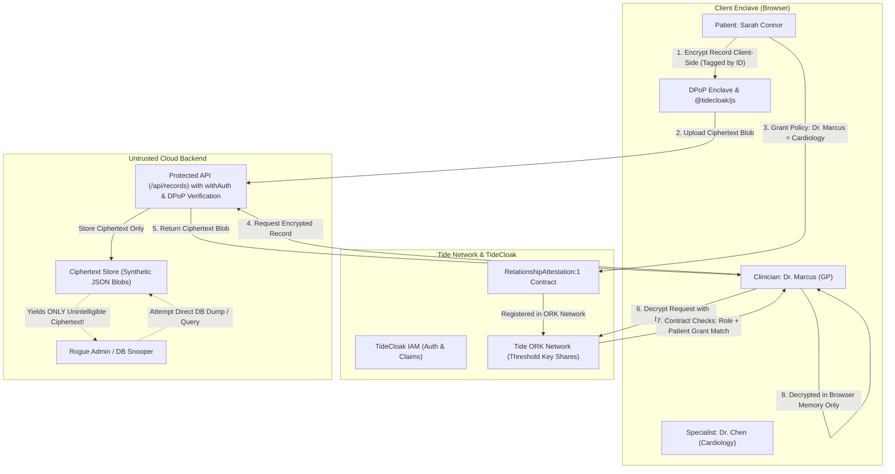
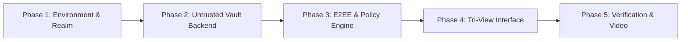

# Implementation Plan: Care Passport (TideCloak Emergent Authority)

## 1. Executive Summary & Challenge Fit

**The UNLOCKED Challenge Prompt**:
> *"Assume trust is solved through Emergent Authority, then build a small working prototype with TideCloak that shows what becomes possible when no single administrator, organisation or AI can unilaterally override the rules protecting people’s data and decisions."*

**Project Name**: **Care Passport**  
**Core Vision**: A patient-governed medical records exchange where health records are encrypted client-side, stored as untrusted ciphertext on the backend, and decrypted only when the patient’s cryptographically active consent policy aligns with an authenticated clinician’s role.  

---

## 2. Why TideCloak Matters: Depth of Integration Assessment

To win the hackathon, the project must decisively overcome the primary warning from the judging committee:
> *"If your app would work exactly the same with ordinary login and backend permissions, develop the idea further. TideCloak should change what it can credibly do."*

### Ordinary Auth (OAuth2 / RBAC / Auth0) vs. Care Passport with TideCloak

| Security Dimension | Conventional Health App (Auth0 / Firebase) | Care Passport (TideCloak + Emergent Authority) |
| :--- | :--- | :--- |
| **Data at Rest** | Plaintext or database-level encryption where the server holds the master key. | **Zero-Knowledge Ciphertext**: Sealed end-to-end; server holds zero decryption keys. |
| **Authority Source** | Centralized backend server `if (user.role === 'clinician')`. | **Emergent Authority**: Decryption keys only emerge across independent ORK nodes when identity, policy, and approvals align. |
| **Server Admin Power** | **Total**: Cloud admin, DBA, or rogue host can run `SELECT *` or bypass auth checks. | **Zero**: An admin with root database access obtains only AES-GCM ciphertext blobs. |
| **Consent Revocation** | Soft flag in database (`is_active = false`), easily bypassed by malicious or buggy code. | **Cryptographic Refusal**: When consent expires or is revoked, Tide Fabric refuses key reconstruction. |
| **Token Hijacking** | Bearer tokens can be intercepted and replayed. | **DPoP Bound Sessions**: Tokens are cryptographically bound to the browser enclave private key. |

---

## 3. The 4-Pillar TideCloak Deep Integration

Our integration leverages TideCloak at every architectural layer:



1. **Client-Side E2EE with Tide Tags**: Records are encrypted before leaving the patient's device using Tide's VVK encryption, tagged strictly with the record's unique ID (`assignmentId`).
2. **Built-in `RelationshipAttestation:1` Contract**: We use Tide's verified, built-in Forseti contract running directly on the ORK network. This contract verifies that:
   - The caller is authenticated with `_tide_decryptor`.
   - The caller matches the policy's `subjectType` (`Role` or `User`).
   - The item's tag exactly matches the patient's `assignmentId`.
   - The active grant has not expired or been revoked.
3. **DPoP Lockstep Token Binding (Invariant I-12)**: All API calls and enclave requests use DPoP proofs, ensuring tokens cannot be stolen or used out-of-context.
4. **Server-Side Proof Verification (Invariant I-03 & I-04)**: The backend API verifies token signatures against the embedded `jwk` in `tidecloak.json` (no insecure remote JWKS fallback).

---

## 4. The Killer Feature: The "Rogue Admin / Breach Simulator"

Most hackathon demos only show a Patient view and a Doctor view. To make our demo unforgettable for the judges, we introduce a third simultaneous dashboard:

### The 3 Perspectives in the UI:
1. **Patient Portal (Sarah Connor)**:
   - View 3 synthetic medical records with varied sensitivity:
     - *Record #1: Routine Lipid Panel (General)*
     - *Record #2: Cardiology Angiogram (Specialist)*
     - *Record #3: Mental Health Clinical Notes (Highly Sensitive)*
   - Granular Consent Toggles: Grant/Revoke access to specific clinicians with live status badges.
2. **Clinician Portal (Dr. Marcus - GP & Dr. Chen - Specialist)**:
   - Switch between clinicians.
   - When granted: Padlock animates green; plaintext appears in browser memory.
   - When not granted / revoked: Padlock animates red; shows raw Tide Fabric error: `Refused by RelationshipAttestation:1: Subject lacks active grant`.
3. **The Rogue Admin / Breach Simulator (The Showstopper)**:
   - Simulates a compromised server, rogue cloud operator, or subpoena scenario.
   - Features a button: **"Simulate Database Compromise / Run `SELECT * FROM records`"**.
   - Displays the raw database payload: completely unreadable AES-GCM ciphertext, IVs, and auth tags.
   - Features a button: **"Attempt Master Key Decryption as Super-Admin"**.
   - Result: **Instant Failure** — *"Mathematical Impossibility: No master key exists in database or server memory. Decryption requires patient policy alignment across Tide Fabric ORKs."*

---

## 5. Technical Stack & Component Plan

### Frontend
- **Framework**: Next.js 14/15 (App Router) + Tailwind CSS + Lucide Icons.
- **Tide Integration**: `@tidecloak/js` and `@tidecloak/nextjs`.
- **Pages**:
  - `/` — Interactive Care Passport Portal with 3-tab Persona Switcher (Patient, Clinician, Rogue Admin).
  - `/auth/redirect` — Canonical Tide post-auth redirect handler.
  - `/public/tide_dpop_auth.html` — Verified Tide DPoP relay page.
  - `/public/silent-check-sso.html` — Tide SSO session checker.

### Backend
- **Framework**: Next.js Server Route Handlers (`src/app/api/records/route.ts`).
- **Auth Middleware**: Server-side JWT verification (`jose` using embedded JWKS from `tidecloak.json`) + DPoP proof verification (`withAuth`).
- **Data Storage**: In-memory / JSON ciphertext repository (stores only synthetic encrypted payloads).

---

## 6. Execution Roadmap



### Phase 1: Environment & Tide Cloak Setup
- Obtain license agreement and email from user.
- Scaffold Next.js project using Tide MCP template structure (`nextjs-e2ee-vault`).
- Configure realm with required roles: `_tide_enabled`, `_tide_encryptor`, `_tide_decryptor`, `patient`, `clinician_gp`, `clinician_specialist`.

### Phase 2: Untrusted Vault Backend
- Implement `/api/records` routes.
- Integrate `withAuth` and `verifyDpop` to ensure strict token verification.
- Seed synthetic medical records (Lipid Panel, Angiogram, Mental Health Notes).

### Phase 3: Client-Side E2EE & Relationship Attestation
- Implement client-side encryption with `@tidecloak/js` / `heimdall-tide`.
- Wire `RelationshipAttestation:1` policy parameters (`assignmentId`, `subjectType`, `subjectId`, `roles`).
- Implement dynamic consent policy issuance and revocation.

### Phase 4: Tri-View Interface & Rogue Admin Console
- Build the responsive UI with Patient, Clinician, and Rogue Admin tabs.
- Implement live status indicators (Padlocks, cryptographic grant receipts, Fabric refusal alerts).
- Build the interactive "Database Breach Simulator".

### Phase 5: Verification & Deliverables
- Run `tide-doctor.sh` to guarantee zero configuration or security invariant flaws.
- Author the public repository `README.md` answering the 5 mandatory judging prompts under 300 words.
- Structure the 2-minute demonstration video script.

---

## 7. Mandatory 300-Word README Draft (Judging Rubric Alignment)

```markdown
# Care Passport — Patient-Governed Medical Sovereignty

### 1. Vision & Originality
Care Passport turns medical records into patient-sovereign cryptographic assets. Instead of trusting centralized hospital databases with lifelong records, patients selectively delegate decryption rights for specific records directly to verified clinicians without creating readable copies in server storage.

### 2. Trust Constraint Insight
Today, healthcare interoperability is paralyzed by custodial trust. Sharing data across clinics requires placing entire unredacted patient histories into centralized cloud repositories where rogue administrators, subpoenaed providers, or database leaks expose everyone’s most intimate records.

### 3. Value & Impact
Patients gain unconditional confidence to disclose sensitive history (e.g. mental health or addiction therapy) to a specialist knowing their general GP or administrative staff cannot access it. Clinics eliminate the existential liability of storing massive pools of plaintext patient records.

### 4. Why TideCloak Matters
Care Passport uses TideCloak’s Emergent Authority and the `RelationshipAttestation:1` contract. Records are sealed with client-side end-to-end encryption before storage. Decryption keys never exist on the server; authority emerges across independent Tide ORK nodes only when the patient’s active policy and the clinician’s authenticated DPoP token align. Even an administrator with root database access obtains only ciphertext.

### 5. Prototype & Key Interaction
Our prototype demonstrates three perspectives:
1. Patient Sarah shares an Angiogram with Dr. Marcus while keeping Mental Health notes private.
2. Dr. Marcus decrypts the Angiogram client-side; his attempt to open Mental Health notes is cryptographically refused by Tide Fabric.
3. Sarah revokes access; immediate subsequent attempts fail.
4. The Rogue Admin Console demonstrates that full backend compromise yields only unintelligible ciphertext with zero bypass capability.
```

---

## User Review Required

> [!IMPORTANT]
> **Tide Realm Licensing Requirements (Invariant AP-90)**:
> Before bootstrapping a TideCloak realm via local Docker or Skycloak, Tide requires:
> 1. A valid administrator license email address (controlled by you).
> 2. Explicit agreement to Tide's Terms & Conditions at https://tide.org/legal.

## Open Questions

> [!IMPORTANT]
> 1. **Hosting Preference**: Would you prefer running TideCloak locally via Docker on your machine, or using Skycloak managed TideCloak?
> 2. **License Email**: What email address should be associated with the TideCloak realm bootstrap?
> 3. **Agreement**: Do you agree to Tide's Terms & Conditions at https://tide.org/legal? (yes/no)
